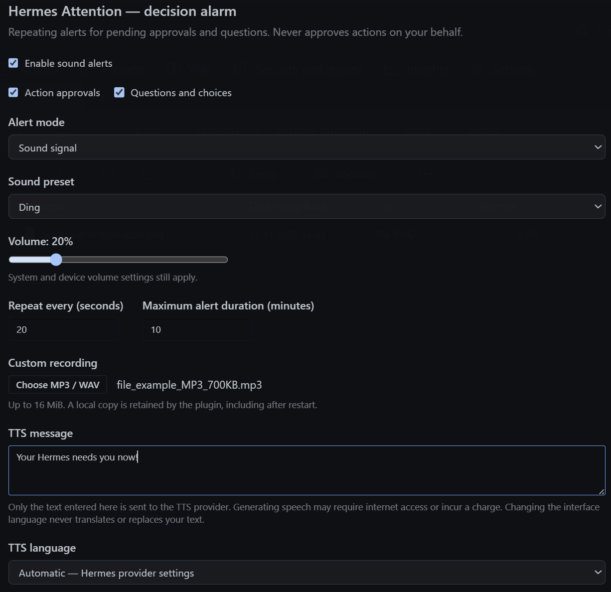

# Hermes Attention


Hermes Attention plays repeating sound alerts when Hermes Desktop needs your approval or an answer. You can step away from your computer and hear when a decision is waiting, instead of finding a missed question later.

It only alerts you. **It never approves actions or answers questions on your behalf.**



## What you can do

- Choose **Ding** for a single chime, **Call** for a telephone-style ring, or **Urgent** for a rapid alarm.
- Adjust the volume, repeat interval and maximum alert duration.
- Get alerts for action approvals, questions and choices, or both.
- Use your own recording or a spoken message instead of a built-in sound.
- Turn alerts on or off from the bell in the top-right corner.
- The interface follows the Hermes language, with English fallback. Your saved speech message stays as you wrote it.

Built-in sounds work offline. You do not need to set up speech generation to use the alarm.

## Install

You need Hermes Desktop with plugin support. **You do not need to build or compile anything.**

1. On this repository's GitHub page, select **Code → Download ZIP**, then extract the downloaded folder.
2. In Hermes Desktop, open **Settings → Plugins** and use the folder/reveal action to open the Desktop plugins folder.
3. Create a folder named `hermes-attention` there. Copy `desktop/plugin.js` from the download into it. The result should look like this:

   ```text
   desktop-plugins/
   └── hermes-attention/
       └── plugin.js
   ```

4. Return to Hermes. The plugin should appear automatically. If it does not, run **Reload desktop plugins** from the command palette. Enable **Hermes Attention** if it is disabled.
5. Open **Settings → Plugins → Hermes Attention**, start with a comfortable volume, and click **Test** to check that you can hear the alarm.

Use the folder opened by Desktop rather than guessing a path on your computer. If you are replacing an existing installation, back up its `hermes-attention` folder first.

That is all you need for built-in sounds and custom recordings. Spoken messages need the optional setup below.

## Use the alarm

The bell lives in the top-right corner of Hermes:


- **Left-click** the bell to turn alerts on or off. A filled bell means on; a crossed-out outline means off.
- **Right-click** the bell to open the Hermes Attention settings directly.
- Mute an individual pending request in the plugin settings if you do not want more reminders for it.

When an alarm sounds, return to Hermes and answer the question or handle the approval. Simply opening the window does not clear a waiting request. **Stop sound** ends the current playback only; use mute or the bell if you also want to stop future repeats.

**Test** plays a single preview of the selected sound or recording. The repeat interval and maximum duration apply to real pending questions and approvals.

### Choose a sound

| Option | What it sounds like |
| --- | --- |
| Ding | A single chime that fades out |
| Call | Pairs of telephone-style rings with pauses |
| Urgent | A fast, alternating two-tone alarm |
| Custom recording | Your own MP3, WAV, OGG or M4A file, up to 16 MiB |
| Spoken message | Text you enter, played as speech; requires the optional setup below |

You can also combine a sound signal with speech. Imported recordings and generated speech are saved locally, so each repeat does not make another speech-generation request.

## Spoken messages (optional)

Skip this section if you only want built-in sounds or your own audio file. No speech recordings are included with the plugin.

<details>
<summary>Set up spoken alerts</summary>

Speech generation needs a small helper installed alongside the Hermes gateway, the service that runs your tasks.

1. Find the Hermes home folder for the gateway/profile you use. This may be different from the Desktop plugins folder. For a remote gateway, install the helper on the remote machine.
2. From the download, copy the `backend` folder into that Hermes home's `plugins` folder and rename the copied folder to `hermes-attention`. Keep all files and subfolders inside it:

   ```text
   plugins/
   └── hermes-attention/
       ├── __init__.py
       ├── plugin.yaml
       └── dashboard/
           ├── manifest.json
           └── plugin_api.py
   ```

3. In a terminal using that Hermes installation and profile, enable the helper:

   ```bash
   hermes plugins enable hermes-attention
   ```

4. Wait for current tasks to finish, then restart that gateway using its normal controls. Reloading the Desktop plugin alone is not enough.
5. Make sure speech generation is configured in Hermes. **Automatic** uses your existing Hermes speech provider and voice. Choosing a specific language uses Edge TTS and requires `edge_tts` in the gateway's Python environment. If it is missing, consult the [Hermes plugin documentation](https://hermes-agent.nousresearch.com/docs/developer-guide/plugins) or the person who manages your gateway.

Enabling the helper is separate from turning on the plugin in Desktop. It uses Hermes' existing connection and security settings; do not run it as a separate public service.

</details>

Once the helper is ready:

1. Open the plugin settings and choose an alert mode that includes speech.
2. Enter your message, such as "Your Hermes needs you now!", and choose its language.
3. Click outside the message field or select a language. The plugin prepares the recording automatically; there is no Generate button.
4. Wait for preparation to finish, then click **Test**.

Choosing a language changes pronunciation, not the words. Write your message in the language you want to hear.

**Speech generation may use the internet and incur provider charges.** Editing the message or selecting a speech language can trigger generation even when a sound-only alert mode is selected. To avoid these requests, leave the speech controls untouched and use built-in sounds or an imported recording. Playing an already-saved recording does not generate it again.

## Troubleshooting

| Problem | What to check |
| --- | --- |
| The bell does not appear | Check the `hermes-attention/plugin.js` folder layout, enable the plugin in Settings, and try **Reload desktop plugins**. |
| I cannot hear the alarm | Turn on the bell, check the plugin and system volume, and click **Test**. Keep Hermes running and your computer awake. |
| The alarm keeps coming back | A question or approval may still be waiting. Answer it, or use mute or the bell. **Stop sound** only stops the current playback. |
| Spoken messages are unavailable | Check the optional helper, the selected gateway/profile and your Hermes speech settings. Restart the gateway after enabling the helper, once active tasks have finished. |
| Speech generation stays busy | A provider may still be processing an earlier request, even after a timeout. Wait for it to finish; if it remains stuck, restart the gateway after active tasks have finished. |

Sound alerts depend on Desktop, your audio device and the gateway connection. They cannot work while your computer is asleep or Hermes is closed, and they are not a guaranteed safety alarm. Playback pauses when the plugin cannot verify whether a request is still waiting.

Local verification has been on Windows. macOS and Linux installation and playback have not been verified end to end.

## Privacy

- Settings and recordings are stored locally in Desktop. The plugin has no telemetry endpoint.
- For speech generation, the message you enter is sent through your Hermes gateway to the selected speech provider. Do not enter secrets or sensitive information.
- The plugin watches approval and question events. It does not request conversation transcripts or read credentials.
- Saved recordings are not encrypted by the plugin. Disabling or uninstalling it does not securely erase local data or provider records.

See [SECURITY.md](SECURITY.md) for more about privacy and reporting sensitive issues.

## For contributors

Development setup, tests and packaging instructions are in [CONTRIBUTING.md](CONTRIBUTING.md). See [CHANGELOG.md](CHANGELOG.md) for changes.

## License

Copyright (c) 2026 **xraysight**. Available under the [MIT License](LICENSE), without warranty. Hermes and speech providers have their own terms; the source license does not grant redistribution rights to recordings you import or generate.
